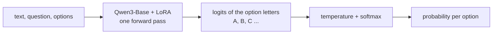

# japanese-jev

**A small decision model for Japanese that returns a probability for each option in a single forward pass, without generating text.**
It reproduces the "System One" approach of TypeSafe AI's Jev on an 8 GB laptop GPU.

[Weights 1.7B](https://huggingface.co/bigrh0917/japanese-jev-qwen3-1.7b-lora) · [Weights 0.6B](https://huggingface.co/bigrh0917/japanese-jev-qwen3-0.6b-lora) · [Evaluation sets](evalsets/) · [Usage](docs/usage.md)

> This is an unofficial reproduction. It is not affiliated with TypeSafe AI or Jev.

## What the model does

You pass a **text, a question and a list of options** in this form:

```
[kind] choice
[state] 先週注文した商品がまだ届きません。配送状況を教えてください。
[question] この文章の主な目的はどれですか。
[options]
A. 依頼: 何かをしてほしいと頼んでいる
B. 質問: 情報を尋ねている
C. 苦情: 不満を訴えている
D. 感謝: お礼を伝えている
[decision]:
```

The model does not generate a continuation. At the last position it reads only the logits of the letters `A` to `D` and returns them as probabilities over the four options (summing to 1).



There are three question types.

| Type | Example | Returns |
| --- | --- | --- |
| choice | What is the intent of this inquiry? request / complaint / question ... | a probability per option |
| noul (yes / no) | Does the writer expect a reply? | the probability of "yes" |
| score (ordinal) | How urgent is this, on a 4-level scale? | a probability per level |

- Base: Qwen3-Base + LoRA (r=16), in **two sizes, 1.7B and 0.6B**
- Training: a few hours on an RTX 4060 Laptop GPU (8 GB)
- Inference: about 25 ms per question with 1.7B (about 14x faster than having the same model generate a JSON answer)

## Main results

Accuracy (%) of the 1.7B model. "4-shot" is the untrained base model given four examples; Jev is the result of sending the same items to the Jev API.

| Evaluation set | 4-shot | This model | Jev 1.14 |
| --- | --- | --- | --- |
| Negation and double negation (self-built, 100 items) | 81.0 | **97.0** | 97.0 |
| Pragmatics: indirect refusals, tatemae, ... (self-built, 300 items) | 53.0 | **69.3** | 89.0 |
| JCommonsenseQA (commonsense, 500 items) | 80.2 | 81.4 | 97.0 |
| MASSIVE (intent classification, 500 items) | 84.0 | 86.0 | 93.4 |

- Training on public data alone did no better on unseen tasks than showing the base model four examples.
- The gains came from adding 1,109 items of kinds that public data lacks (negation, indirect refusals, honorifics and hierarchy, ...).
- Jev itself is still clearly ahead on the same items.

The self-built evaluation sets and the synthetic training data were both written by Claude (Anthropic's AI), so the numbers on the self-built sets are optimistic. All numbers are from test sets that were looked at during development. All evaluation sets, the 0.6B numbers and the caveats are under [Detailed results](#detailed-results).

## Try it

```bash
pip install torch transformers peft
```

```python
import torch
from transformers import AutoModelForCausalLM, AutoTokenizer
from peft import PeftModel

BASE = "Qwen/Qwen3-1.7B-Base"
ADAPTER = "bigrh0917/japanese-jev-qwen3-1.7b-lora"
LETTERS = "ABCDEFGHIJKLMNOP"
# values from the bundled temperature.json; they correct the model's over-confidence
TEMPERATURE = {"choice": 2.09, "noul": 1.80, "score": 1.64}

tok = AutoTokenizer.from_pretrained(BASE)
model = AutoModelForCausalLM.from_pretrained(BASE, dtype=torch.bfloat16)
model = PeftModel.from_pretrained(model, ADAPTER).merge_and_unload().eval()
model.to("cuda" if torch.cuda.is_available() else "cpu")


def decide(kind, state, question, options):
    """options is a list of (name, description); the description may be empty. Returns a probability per option."""
    lines = [f"[kind] {kind}", f"[state] {state}", f"[question] {question}", "[options]"]
    lines += [f"{LETTERS[i]}. {name}: {desc}" if desc else f"{LETTERS[i]}. {name}"
              for i, (name, desc) in enumerate(options)]
    lines.append("[decision]:")
    enc = tok("\n".join(lines), return_tensors="pt").to(model.device)
    ids = [tok.encode(" " + c, add_special_tokens=False)[0] for c in LETTERS[:len(options)]]
    with torch.no_grad():
        logits = model(**enc).logits[0, -1, ids].float()
    probs = torch.softmax(logits / TEMPERATURE[kind], dim=-1).tolist()
    return {name: round(p, 3) for (name, _), p in zip(options, probs)}


print(decide(
    "choice",
    "先週注文した商品がまだ届きません。配送状況を教えてください。",
    "この文章の主な目的はどれですか。",
    [("依頼", "何かをしてほしいと頼んでいる"), ("質問", "情報を尋ねている"),
     ("苦情", "不満を訴えている"), ("感謝", "お礼を伝えている")],
))

print(decide("noul", "行けたら行くね。", "話し手は来る可能性が高いですか。", [("yes", ""), ("no", "")]))
```

`decide` returns a mapping from option names to probabilities. Keep the input format identical to training: noul options are `yes` then `no`, and score options go from the lowest level to the highest. Without a CUDA GPU, use `dtype=torch.float32`. Settings for 0.6B are in its [model card](https://huggingface.co/bigrh0917/japanese-jev-qwen3-0.6b-lora).

## Detailed results

Accuracy (%). "4-shot" is the untrained base model given four examples, the control for what training adds. Jev is the TypeSafe API (Jev 1.14, through OpenRouter) on the same items.

| Evaluation set | Items | 0.6B 4-shot | 0.6B model | 1.7B 4-shot | 1.7B model | Jev 1.14 |
| --- | --- | --- | --- | --- | --- | --- |
| Held-out items from the training sources (all three types) | 1,000 | 49.6 | 77.0 | 57.9 | **80.0** | – |
| JCommonsenseQA (commonsense, 5-way) | 500 | 67.0 | 62.4 | 80.2 | 81.4 | 97.0 |
| MASSIVE (intent classification, 8-way) | 500 | 75.6 | 80.0 | 84.0 | 86.0 | 93.4 |
| livedoor news (9 categories) | 500 | 48.0 | 48.4 | 50.8 | 52.4 | – |
| WRIME (emotion intensity, score) [1] | 500 | 50.0 | 62.2 | 54.8 | 67.0 | – |
| JCoLA (sentence acceptability, noul) [2] | 500 | 49.8 | 52.2 | 52.6 | 57.2 | – |
| ja_negation (negation and double negation, self-built, noul) | 100 | 69.0 | 96.0 | 81.0 | **97.0** | 97.0 |
| ja_ambiguity (pragmatics, self-built, all three types) | 300 | 46.7 | 61.3 | 53.0 | **69.3** | 89.0 |
| ja_knowledge (readings, counters, honorifics, ..., self-built) [3] | 200 | 41.0 | 42.5 | 53.0 | 51.5 | 84.0 |

The 0.6B model was trained with the same recipe as 1.7B. Negation and pragmatics, which the synthetic data targets, improve a lot on 0.6B too, but on JCommonsenseQA it falls below its own 4-shot baseline (62.4 vs 67.0). It is lower than 1.7B on almost every set, with the largest gap on JCommonsenseQA (19 points). Use 1.7B for accuracy and 0.6B when memory is tight.

- [1] 81% of WRIME items are "no emotion", so instead of accuracy this row reports the average of "share of no-emotion items answered correctly" and "share of emotion items detected" (50 by chance).
- [2] Sampled so that natural and unnatural sentences are half and half; 50 by chance.
- [3] The Jev number was measured on the version before the question wording was revised.

**Reading these numbers**

- They come from test sets that were looked at many times during development. A sealed set that has never been looked at exists but has not been run.
- The margin of error is about ±3-4 points at 500 items, ±5.5 at 300 and ±8 at 100. There is a single random seed.
- The three self-built sets and the synthetic training data were both written by Claude (Anthropic's AI). Because they share the same habits, the numbers on the self-built sets are optimistic.
- On JCommonsenseQA, MASSIVE, livedoor and ja_knowledge, the difference between the trained model and 4-shot is within noise. What training improved is negation, pragmatics and emotion intensity, the areas the synthetic data covers.
- MASSIVE is an 8-way task here (the correct intent plus 7 sampled wrong ones), which is easier than the original 60-way setting.

### Speed

| Setting | Per question |
| --- | --- |
| 1.7B, one question at a time (LoRA merged) | 25 ms |
| 1.7B, batches of 8 | 12 ms |
| Untrained base model + 4 examples | 94 ms |
| Same model generating a JSON answer (15 tokens) | 344 ms |
| Jev API, one question at a time (from Japan through OpenRouter, including network time) | 377 ms |

Measured on an RTX 4060 Laptop GPU. The 0.6B speed is not listed because it has not been re-measured under the same conditions. Most of Jev's 377 ms is network time, so this is not a comparison of model speed. What can be said is that running locally removes the network round trip, and that reading probabilities is an order of magnitude faster than having the same model generate an answer.

### Is the confidence usable?

After training the model is over-confident (temperature-scaling temperatures of 1.6 to 2.1). On the training sources, temperature scaling lowers ECE from 0.114 to 0.043. The same temperatures do not transfer as they are to other datasets.

As an example of using the confidence, the table below is computed from existing predictions for the case where the local model answers only the items it is confident about and the rest go to Jev.

| Evaluation set | Local only | Jev only | Local answers only at confidence ≥ 0.7 (share answered locally / combined accuracy) |
| --- | --- | --- | --- |
| MASSIVE | 86.0 | 93.4 | 73% / 92.2 |
| JCommonsenseQA | 81.4 | 97.0 | 58% / 94.4 |
| ja_ambiguity | 69.3 | 89.0 | 76% / 78.3 |

On MASSIVE, skipping about 70% of the API calls leaves the combined accuracy close to Jev alone. The threshold was compared after the fact on the same test set, so treat this as a rough guide. On tasks where the local model is weak (pragmatics) the benefit is smaller.

## Findings

1. **LoRA training on public data alone did no better on unseen tasks than showing four examples.** What it bought was speed, a stable output format (the share of items answered the same way after shuffling the options went from 0.69 to 0.93) and accuracy on the trained tasks.
2. **What worked was adding a small amount of data of kinds that public data lacks.** Adding 1,109 synthetic items (negation minimal pairs, indirect refusals, honorifics and hierarchy, ...) moved pragmatics from 53 to 69 and negation from 81 to 97.
3. **In continued training, the choice of checkpoint changes the result.** With the setting that picks the checkpoint with the lowest validation loss on the old tasks, the weights from step 100 were selected (pragmatics 63.3). The weights trained to the end score 69.3, and are more over-confident.
4. **Comparing against 0-shot overstates the effect of training.** JCommonsenseQA is 54% at 0-shot, 80% at 4-shot and 81% after training.

### Tried without effect

- Distillation with Jev's probabilities as the teacher (compared on 9,510 items; no difference from training on the labels alone)
- A second, broader batch of synthetic data (1,965 items)
- Adding the JCoLA training split (2,300 sentences)

### Evaluation mistakes that were fixed

- The 500 livedoor test items were all from one category (the resulting 95% was an artifact; with stratified sampling it is about 50%)
- The conclusion that "training broke double negation" came from 20 skewed items (checked with 100 purpose-built minimal pairs)
- The self-built sets marked some currently accepted usages as wrong (e.g. うさぎ → 匹). These were found by comparing against Jev's answers, and the question wording was revised

## Limitations

- **Weak on all-hiragana input**: accuracy drops by 13 to 47 points (measured with the step-100 weights). On other items with the same transform, Jev dropped by about 8 points on average.
- **score (ordinal) questions are the weakest**: 63% even on the training sources.
- **It cannot do kinds of tasks it was not trained on**: JCoLA (sentence acceptability) is close to chance.
- **Knowledge does not increase**: ja_knowledge is unchanged by training.
- **The gap to Jev is large**: 16 points on commonsense, 20 on pragmatics and more than 30 on knowledge.
- Jev can answer several questions in one request; this implementation runs one forward pass per question.

## Reproducing the training

```bash
uv sync && source .venv/bin/activate
python tests/test_pipeline.py                 # needs no model or data, takes seconds
hf download Qwen/Qwen3-1.7B-Base --local-dir models/Qwen3-1.7B-Base

japanese-jev build --config configs/qwen3-1.7b-ja.json        # fetch public data and write data/*.jsonl
bash scripts/train.sh --config configs/qwen3-1.7b-ja.json     # train -> calibrate temperatures -> evaluate
python scripts/make_continue_set.py 5000 5 data_ft            # synthetic data + part of the original training data
bash scripts/train.sh --config configs/qwen3-1.7b-ja-ft.json  # continued training (point init_adapter at the output above)
python scripts/report.py runs/<dir>/evaluation.json           # result table
```

Developed on Linux + CUDA (including WSL2). Training code for Mac (MLX) is included but has not been verified on a real machine. Commands and config keys are described in [docs/usage.md](docs/usage.md).

## Repository layout

| Path | Contents |
| --- | --- |
| `src/japanese_jev/` | template, probability readout, training, temperature calibration, evaluation, API server |
| `src/japanese_jev/data_pipeline/` | adapters that convert public datasets into the three question types |
| `scripts/` | training (`train.sh`), result table (`report.py`), paired comparisons and confidence intervals (`audit.py`), synthetic data generators, ... |
| `evalsets/` | three self-built evaluation sets (600 items in total, CC BY 4.0) |
| `datasets/synthetic/` | the synthetic training data |
| `results/` | evaluation results (JSON) of the final and base models in both sizes |
| `docs/` | commands and configuration |

## Data and licenses

- Code: MIT
- Self-built evaluation sets and synthetic data: CC BY 4.0
- LoRA weights: CC BY-SA 4.0 (the training data includes CC BY-SA datasets)
- Public data used for training: JNLI, JSICK, JSTS, KUCI, PAWS-X (Japanese), MewsC-16-ja
- Public data used only for evaluation: JCommonsenseQA, MASSIVE, livedoor news corpus, WRIME, JCoLA. SIB-200 is used for temperature calibration

The public datasets themselves are not included in this repository; `japanese-jev build` fetches them from their distributors. WRIME and the livedoor news corpus have redistribution conditions, so their converted files are not included either. See [LICENSES.md](LICENSES.md) for details.
